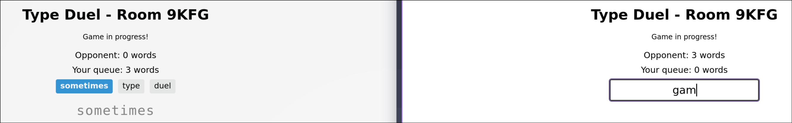

# Type Duel

Type Duel is a real-time, two-player typing game played in the browser. Every word you type is sent to your opponent as a word they have to type back. Each player's queue of incoming words grows, and the first player whose queue reaches 10 words loses. Built with Rust, Axum and WebSockets.



There's no hosted demo yet. To play, run it locally and open the room link in two browser windows (see [Getting started](#getting-started)).

## What it does

- Create a room and share its link. The second person to open it is your opponent.
- Both players click Ready, then get a 3-2-1 countdown.
- **Attack:** type any real English word (3+ letters) and press Space or Enter to send it to your opponent. Words are checked against a 172k-word dictionary, and you can't send the same word twice in a row.
- **Defense:** when words arrive, you switch to typing them back. Each letter turns green or red as you type, and the word clears on its own when it's right. If you're halfway through an attack word, you get to send it before the switch.
- Both players see their own queue size and their opponent's at all times.
- You win when your opponent's queue reaches 10 words. If a player disconnects mid-game, their opponent wins after 5 seconds.
- After the game, both players see a stats table (words sent, words defended, longest word, average WPM). When both players click Play Again, a rematch starts in the same room.

## How it works

One Axum server serves the pages and the WebSocket endpoint. The server holds all game state in memory, and the browser just shows it.

```
src/
  main.rs        binds :3000 and starts the server
  lib.rs         router: /, /create-room, /game/{code}, /ws/{code}
  game.rs        Room, PlayerState and the room state machine; no networking
  handlers.rs    HTTP and WebSocket handlers, plus the game page's HTML/JS
  dictionary.rs  word validation against the embedded word list
tests/
  integration_test.rs  starts a real server and plays games over real WebSockets
```

A room moves through `WaitingForPlayers → WaitingForReady → Countdown → Playing → GameOver`, then back to `WaitingForReady` for a rematch. Each step checks the current state before acting, so a `submit_word` sent during the countdown is ignored, and so is a second `play_again` after the room has already reset.

### Fan-out without holding a lock across `.await`

All rooms sit in one `Arc<Mutex<HashMap<String, Room>>>`. Each WebSocket connection runs its own task, which owns the socket and the receiving end of an unbounded `mpsc` channel. The room keeps the sending ends. The task's loop uses `tokio::select!` to wait on two things at once: a frame from its own client, or a message on its channel from anywhere in the server.

So game logic never touches a socket. It handles a message, updates the `Room` under the lock, and pushes JSON onto the players' channels. Unbounded sends are synchronous, so the `std::sync::Mutex` is never held across an `.await`. The one handler that does need to wait is the countdown, which sleeps between ticks. It copies the senders, drops the lock, and runs in a spawned task, then takes the lock again only to switch the room to `Playing`.

### The server is the source of truth

The client keeps its own copy of the defense queue so it can redraw on every keystroke. The server doesn't trust that copy:

- Every attack word is checked on the server (length, `[a-z]` only, in the dictionary, not the same as the last word sent) before it's added to the opponent's queue.
- A `word_completed` counts only if it matches the word at the front of that player's queue on the server. Otherwise nothing happens.
- Overflow is checked on the server right after each word is sent, and the server sends the `game_over` message and stats to both players.

Restricting words to lowercase ASCII also covers the client's `innerHTML` rendering of opponent words. A word only reaches another player after the server has validated it, so markup can't be injected through the word queue.

### A 172k-word dictionary in the binary

The first word list was the EFF diceware list (7,776 words). It was missing words like "where", "this" and "game", which made the game feel broken. It was replaced with ENABLE (172,727 words). A regression test now checks that about 90 common words are in the dictionary.

The list is built into the binary with `include_str!` and parsed on first use into a `LazyLock<HashSet<&'static str>>`. The set stores slices of the built-in text instead of a new `String` per word. There's no file to load at runtime, and the release build is one ~4 MB binary.

### Limitations

- Game state lives only in memory. Restarting the server ends every game, and rooms are never cleaned up.
- A dropped connection can't rejoin. Disconnecting mid-game counts as a forfeit after 5 seconds.
- The frontend is plain HTML/JS, written inline in `handlers.rs`. It has no build step and no framework.

## Stack

- **Rust** (2024 edition), **Tokio**, **Axum 0.8** with WebSockets
- **serde_json** for the message format, **rand** for room codes
- Plain HTML/CSS/JS on the frontend
- Tests use **tokio-tungstenite** and **reqwest** as real clients against a server on a random port

## Getting started

Requires Rust 1.85 or newer (for the 2024 edition).

```sh
cargo run --release      # http://localhost:3000
```

Click **Create Room**, then open the room URL (`/game/XXXX`) in a second window or on another device. The server listens on `0.0.0.0:3000`, so another device on your local network can join at `http://<your-ip>:3000/game/XXXX`. The port is fixed in `src/main.rs`.

## Testing

```sh
cargo test
```

This runs 49 unit tests for the game rules and dictionary, and 29 integration tests. Each integration test starts the server on a random port and connects two WebSocket clients. Together they cover joining, a full room, ready-up and countdown, word rejection, attack and defense, queue overflow, disconnect forfeits, stats and rematches. The integration tests take about 10 seconds because the countdown and disconnect timers run in real time.
